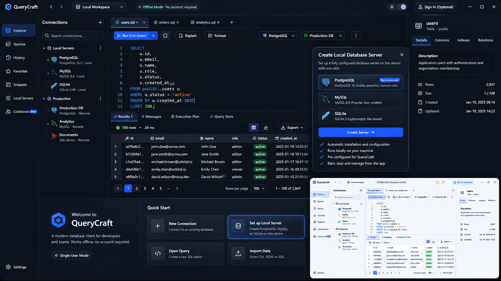

<div align="center">

<picture>
  <source media="(prefers-color-scheme: dark)" srcset="docs/brand/qlueprint-logo-dark.svg">
  
</picture>

### Every Database. One Workspace.

QluePrint (_KLOO-print_) is a local-first desktop workspace for your databases.
Connect to PostgreSQL, MySQL, MariaDB, SQL Server and SQLite, write and run SQL, browse and edit data, and spin up local database servers in a click. No account, no cloud, no telemetry.

[Download](https://github.com/u-ninja/qlueprint/releases/latest) · [Features](#features) · [Install](#install) · [Build from source](#build-from-source) · [License](#license)

</div>



<sub>Design concept. The shipping app follows the same design language; real screenshots are coming.</sub>

## Features

**Connections**

- PostgreSQL, MySQL, MariaDB, SQL Server and SQLite.
- Azure SQL and Microsoft Fabric warehouses with Microsoft Entra sign-in (MFA, Azure CLI, managed identity), including guest accounts in another tenant.
- Passwords and sign-ins live in your system’s credential store (Keychain, Credential Manager, Secret Service), never in plain files.
- **Workspaces**: keep each client’s connections and query tabs apart, and switch between them from the top bar.

**Explorer**

- Databases, schemas, tables, views, stored procedures and functions, grouped and filterable.
- Table sizes at a glance, and an inspector with columns, keys, indexes, foreign keys and DDL.
- Open a procedure or function’s definition in a new query tab.

**SQL editor**

- Monaco editor with schema-aware autocomplete, diagnostics and formatting.
- Several query tabs, each with its own connection and database.
- Explain and Explain Analyze with a readable plan.

**Results and data**

- A fast, virtualized grid: sort, filter and find, with sorting done by the database when a result is cut off.
- Edit cells in table tabs and in single-table query results. Changes are staged, undoable and saved in one transaction.
- Follow foreign keys to related rows; copy rows as CSV, JSON or INSERT statements.

**Local servers**

- Create a PostgreSQL, MySQL or MariaDB server in Docker, or a SQLite file, with its connection set up for you. Start, stop and inspect logs from the app.

**Trust**

- A tamper-evident audit log of everything the app ran against your databases, kept on your machine.
- Light and dark themes, full keyboard navigation and accessible contrast.

Not built yet: MongoDB and Redis support, a saved query library, the query history view and team collaboration. See the [product spec](docs/product-spec.md) for what’s planned.

## Install

Download the installer for your system from the [latest release](https://github.com/u-ninja/qlueprint/releases/latest).

| System                | File                                          |
| --------------------- | --------------------------------------------- |
| macOS (Apple Silicon) | `qlueprint_<version>_aarch64.dmg`             |
| Windows (64-bit)      | `qlueprint_<version>_x64-setup.exe` or `.msi` |
| Linux (64-bit)        | `.AppImage`, `.deb` or `.rpm`                 |

**First launch.** The builds aren’t notarized by Apple or signed for Windows yet, so the system asks once:

- **macOS 15 or later:** open the app, close the warning, then go to **System Settings → Privacy & Security** and click **Open Anyway**. Or run `xattr -dr com.apple.quarantine /Applications/qlueprint.app`.
- **macOS 14 and earlier:** right-click the app and choose **Open**.
- **Windows:** on the SmartScreen prompt, click **More info → Run anyway**.

## Build from source

You need [Node.js](https://nodejs.org) (current LTS or newer), [pnpm](https://pnpm.io), [Rust](https://www.rust-lang.org/tools/install) and the [Tauri prerequisites](https://tauri.app/start/prerequisites/) for your system.

```sh
cd apps/desktop
pnpm install
pnpm tauri dev      # run it
pnpm tauri build    # make installers in src-tauri/target/release/bundle
```

Local database servers need [Docker](https://www.docker.com) running.

<details>
<summary>Optional: the cloud API (sign-in, not used by the app yet)</summary>

The desktop app works without it. To run it, create `apps/api/.env`:

```sh
DATABASE_URL=postgres://...         # PostgreSQL connection string
NEON_AUTH_URL=https://...           # Neon Auth base URL
PORT=8080                           # optional, defaults to 8080
CORS_ORIGIN=http://localhost:1420   # optional, comma-separated origins
```

Then:

```sh
cd apps/api
pnpm install
pnpm db:migrate
pnpm dev
```

And point the desktop app at it in `apps/desktop/.env`:

```sh
VITE_NEON_AUTH_URL=https://...      # same Neon Auth base URL as the API
VITE_API_URL=http://localhost:8080
```

</details>

## Tech stack

| Layer         | Technology                                                                                                         |
| ------------- | ------------------------------------------------------------------------------------------------------------------ |
| Desktop UI    | [Tauri 2](https://tauri.app), React 19, TypeScript, Vite, Tailwind CSS, Monaco Editor                              |
| Local backend | Rust inside the app: database drivers (sqlx, tiberius), OS credential store, Docker. No local server, no open port |
| Cloud API     | Node.js, [Fastify](https://fastify.dev), [Drizzle ORM](https://orm.drizzle.team), PostgreSQL on Neon               |

```text
qlueprint/
├── apps/
│   ├── desktop/   # The app: React UI in src/, Rust backend in src-tauri/
│   └── api/       # Optional cloud API for sign-in and, later, collaboration
└── docs/          # Product spec and design
```

## Brand

Logo files, light and dark, one-colour and the app icon are in [docs/brand](docs/brand). The name is written **QluePrint**: capital Q, capital P, one word.

## Documentation

- [Product, UX and design system spec](docs/product-spec.md)
- [Design prototype](docs/design/README.md)

## License

QluePrint is **source-available** under the [PolyForm Shield License 1.0.0](LICENSE.md).

You may use, study, modify and share it for free, at home or at work. You may **not** use it, or code taken from it, to build or offer a product that competes with QluePrint. For any other arrangement, [open an issue](https://github.com/u-ninja/qlueprint/issues) to ask.

It is not an OSI open-source license. Third-party code keeps its own license: the vendored SQL Server driver in `apps/desktop/src-tauri/vendor/tiberius` is MIT or Apache-2.0, and dependencies keep theirs.

Copyright 2026 u-ninja.
