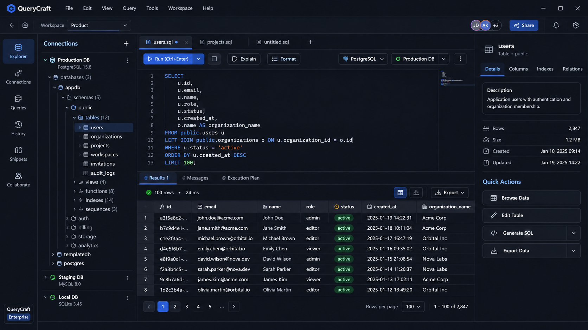
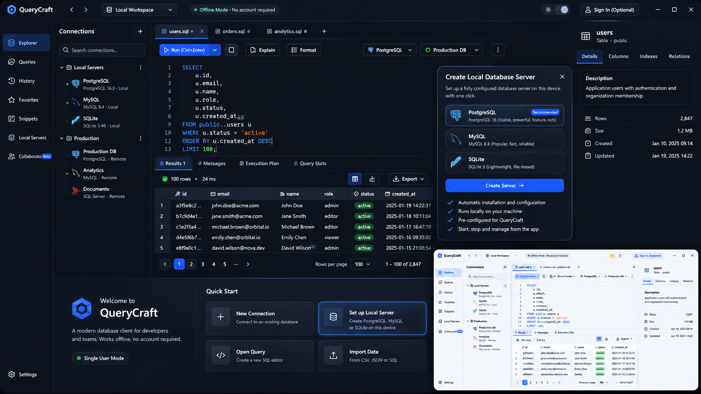
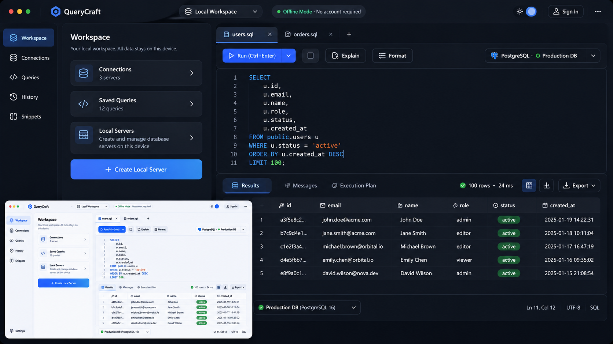

# QueryCraft — Product, UX, Design System & Local Database Provisioning Specification

|                       |                                                                                         |
| --------------------- | --------------------------------------------------------------------------------------- |
| **Status**            | Product and engineering specification                                                   |
| **Product**           | QueryCraft                                                                              |
| **Design language**   | Obsidian Flow                                                                           |
| **Primary platform**  | Windows desktop first; architecture must remain cross-platform                          |
| **Application model** | Local-first desktop application with optional cloud collaboration                       |
| **Audience**          | Individual developers, database administrators, engineering teams, and enterprise users |

_Design concepts. Mockups only; not the current state of the app._

| SQL workspace                                  | Create local server & quick start                                                 | Local workspace home                                                   |
| ---------------------------------------------- | --------------------------------------------------------------------------------- | ---------------------------------------------------------------------- |
|  |  |  |

The second and third concepts show the signed-out experience from [§2.5](#25-accounts-and-sign-in): an "Offline Mode · No account required" indicator, an optional "Sign in" button, and the Create Local Server flow from [§6.4](#64-creation-flow). Each concept is shown in dark theme with a light-theme inset.

---

## 1. Product definition

QueryCraft is a professional database workspace that combines database administration, SQL development, data exploration, and team collaboration in one desktop application.

It should compete with established database IDEs while offering a more approachable, coherent, and modern experience. It must be powerful enough for experienced engineers and understandable to developers who do not work with databases every day.

### Product principles

1. **Local-first and account-free.** A single user can install QueryCraft and use every non-collaboration feature without ever creating an account or signing in, and without depending on cloud services. See [§2.5](#25-accounts-and-sign-in).
2. **Safe by default.** Connections, credentials, queries, and destructive operations must be handled deliberately.
3. **Progressive disclosure.** Common workflows are obvious; advanced controls are available when needed.
4. **Fast and responsive.** Large schemas and result sets must not make the interface unusable.
5. **Consistent.** Navigation, terminology, actions, errors, and visual patterns behave consistently.
6. **Collaborative when requested.** Cloud collaboration is optional and must not silently expose local database access.
7. **Accessible.** Light and dark themes, keyboard operation, readable contrast, and clear focus states are mandatory.
8. **Operationally transparent.** Users must understand what QueryCraft installs, starts, downloads, changes, and stores on their device.

### Product positioning

QueryCraft is not just a SQL editor. It is a database workspace with:

- Database connections and discovery.
- SQL editing and execution.
- Data browsing and editing.
- Schema inspection and management.
- Query history and saved snippets.
- Local database server provisioning.
- Optional shared workspaces and real-time collaboration.
- Export, import, and backup workflows.

## 2. Product architecture

The architecture has three distinct areas.

### 2.1 Desktop application

- Tauri 2
- React
- TypeScript with strict compiler settings
- Vite
- Tailwind CSS
- shadcn/ui and accessible primitives
- Zustand for appropriate client state
- Monaco Editor for SQL editing
- TanStack Table or an equivalent virtualized grid
- Zod for validating data the UI receives from outside the app (for example the cloud API)

Responsibilities:

- Render the application UI.
- Manage local workspace and user preferences.
- Call the local backend through Tauri commands and listen to its events.
- Display database connections, query results, and local server lifecycle.
- Authenticate to the optional cloud service when the user chooses to sign in.

### 2.2 Local backend (Rust, inside the Tauri app)

All local work runs in the Rust side of the Tauri app (`apps/desktop/src-tauri`). There is no separate local HTTP server.

- Rust, async on Tokio (Tauri's runtime)
- Tauri commands for request/response calls and Tauri events for progress streams
- Database drivers: `sqlx` (PostgreSQL, MySQL, SQLite) and `tiberius` (SQL Server), with `tokio-postgres` or `rusqlite` where a feature such as query cancellation needs them
- OS keychain access through the `keyring` crate
- Structured logging with secret redaction

The local backend handles:

- Database driver operations.
- Connection lifecycle.
- Schema discovery.
- Query execution and cancellation.
- Local database server provisioning orchestration.
- Local metadata and query history.
- Credential storage in the OS keychain.

Why Rust instead of a Node.js local API:

- **Nothing extra to ship or run.** No Node runtime bundled as a sidecar, no second process to start, monitor, and stop.
- **No local port.** The frontend reaches the backend only through Tauri's IPC, so there is no loopback server that other programs on the machine could call, and no per-install token to manage.
- **Permissions are explicit.** Every command must be allowed in a Tauri capability file (`src-tauri/capabilities/`); anything not listed is rejected.

Rules for the local backend:

- Expose narrow, validated commands. Never a "run this shell command" command.
- Validate every command argument in Rust, even though it comes from our own UI.
- Return typed errors with a stable code and a safe message; never include credentials or raw connection strings.

### 2.3 Optional cloud backend

`apps/api`, a separate service that the desktop app only calls when the user signs in.

- Node.js + Fastify (existing code: plugins, error handling, module pattern, TypeBox route schemas)
- PostgreSQL as the primary persistent application database
- WebSockets for real-time communication
- Yjs or another suitable CRDT for collaborative documents
- Redis only when cross-instance coordination or ephemeral distributed state requires it
- Object storage for attachments or larger exported artifacts if needed

Cloud responsibilities:

- User accounts and authentication.
- Organizations and membership.
- Workspaces, projects, and shared documents.
- Roles and permissions.
- Invitations and audit records.
- Collaboration sessions and durable document persistence.

The cloud backend must not be required for ordinary local database management.

### 2.4 Data and trust boundaries

The local database server, the desktop app (UI and Rust backend), and the cloud service are separate trust domains.

- Database credentials remain local by default.
- Database connections are created from the user's device.
- Sharing a query document does not share database credentials.
- Cloud collaboration must not transmit query results or database contents unless a distinct, explicit feature requires it and the user approves.
- The local backend must not become a general-purpose execution service: no network listener, and no command that runs arbitrary programs.
- Cloud APIs must never be able to issue arbitrary commands on the user's machine.

### 2.5 Accounts and sign-in

A single user must be able to use QueryCraft indefinitely without ever signing in.

- **No sign-in wall.** The app opens straight into the local workspace. Launch, onboarding, and every local feature work signed out.
- **Signed-out scope.** Connections, explorer, SQL workspace, data browsing, history, snippets, local servers, settings, import/export, and backup all work without an account.
- **Offline.** All of the above keep working with no network connection, apart from operations that inherently need the network (for example downloading a database runtime).
- **Sign-in is opt-in.** Sign-in is offered only from the Collaborate area, a share action, or an explicit "Sign in" entry in the shell. It is never a precondition for local work.
- **Account features only.** An account unlocks only cloud features: organizations, shared workspaces, shared documents and snippets, live collaboration, and invitations.
- **Signing in or out never moves or removes local data.** Local connections, credentials, history, and snippets stay on the device. Moving anything to the cloud is a separate, explicit action.
- **No hidden telemetry account.** The app must not create an anonymous cloud identity in the background.

## 3. Application information architecture

### 3.1 Primary navigation

Use a compact, persistent left navigation rail with these destinations:

1. **Explorer** — connections, databases, schemas, tables, views, functions, indexes.
2. **Connections** — saved connections and connection management.
3. **SQL Workspace** — editor tabs, saved query documents, and query execution.
4. **Data** — table browsing and data editing.
5. **History** — recent queries, execution outcomes, and filters.
6. **Snippets** — reusable SQL snippets and templates.
7. **Local Servers** — locally provisioned database instances and their lifecycle.
8. **Collaborate** — shared workspaces, members, invitations, and live sessions. Signed out, this shows what collaboration offers and a sign-in action.
9. **Settings** — application preferences, themes, shortcuts, drivers, security, and updates.

The navigation may collapse to icons, but tooltips and accessible labels must remain available.

### 3.2 Global application chrome

The desktop shell should contain:

- Application menu and product identity.
- Workspace switcher.
- Current environment indicator where relevant.
- Global search / command palette.
- Collaboration avatars and share action when signed in; a quiet "Sign in" entry when signed out.
- Notifications or task activity.
- Settings access.
- Native window controls handled consistently with Tauri.

Avoid duplicating operating-system title bar controls or creating confusing nested title bars.

### 3.3 Main workspace layout

The default SQL workspace uses a resizable three-region layout:

- **Left explorer:** connection tree and object navigation.
- **Center workspace:** SQL editor tabs and query results.
- **Right inspector:** contextual information about the selected database object.

The right inspector must be hideable. The left explorer must be resizable and collapsible. The editor/results split must be resizable.

Persist panel widths and visibility per user preference, with a sensible reset-layout action.

### 3.4 Responsive behavior

Although desktop is the primary target, the layout must handle smaller windows:

- Collapse the navigation rail before shrinking critical editor content.
- Allow the inspector to become an overlay or secondary tab.
- Keep query execution and connection status accessible.
- Avoid horizontal overflow in dialogs and settings.
- Ensure tables use horizontal scrolling or column visibility controls where necessary.

## 4. Design system — Obsidian Flow

### 4.1 Design goals

The UI must feel:

- Enterprise-grade.
- Modern and restrained.
- Professional rather than playful.
- Dense enough for technical work.
- Clear enough for occasional database users.
- Consistent across the entire application.
- Comfortable for long working sessions.

Avoid excessive gradients, glowing borders, glassmorphism, oversized dashboard cards, unnecessary animations, and decorative visuals that reduce usable space.

### 4.2 Theme strategy

Light and Dark are both first-class themes. Neither is an afterthought.

Provide three appearance settings:

- Light
- Dark
- System — follows the operating system preference

The selected theme applies consistently to:

- Application shell.
- Menus and context menus.
- Dialogs and popovers.
- Monaco Editor.
- Results grid.
- Charts and visual explain plans.
- Notifications and toasts.
- Empty states and onboarding.
- Native-looking custom title bar areas where controlled by the app.

Theme switching must not require an application restart. Persist the preference locally.

### 4.3 Color foundations

Use semantic design tokens. Components consume semantic tokens rather than hardcoded hex colors.

**Dark theme direction**

- App background: deep graphite / charcoal.
- Primary surface: slightly lighter graphite.
- Elevated surface: distinct charcoal.
- Borders: subtle neutral grey.
- Primary text: soft white, not pure white everywhere.
- Secondary text: cool muted grey.
- Primary accent: restrained electric blue.
- Success: accessible green.
- Warning: amber.
- Danger: red.
- Information: blue or cyan with sufficient contrast.

**Light theme direction**

- App background: cool off-white or very light neutral.
- Primary surface: white.
- Elevated surface: white with subtle border or shadow.
- Borders: light neutral grey.
- Primary text: dark graphite.
- Secondary text: muted slate.
- Primary accent: a deeper blue than the dark theme accent to preserve contrast.
- Status colors tuned separately for light surfaces.

Do not simply invert dark theme colors. The light theme needs its own contrast and elevation decisions.

**Semantic token groups**

`background`, `foreground`, `surface`, `surface-elevated`, `surface-muted`, `surface-hover`, `surface-selected`, `border`, `border-strong`, `input`, `ring`, `primary`, `primary-foreground`, `secondary`, `muted`, `muted-foreground`, `accent`, `success`, `warning`, `danger`, `info`, `editor-background`, `editor-foreground`, `grid-header`, `grid-row-hover`, `grid-row-selected`, `focus`.

Maintain WCAG 2.2 AA contrast for normal text and interactive controls wherever applicable. Do not use color alone to convey status.

### 4.4 Typography

Use a clean, highly legible UI typeface such as Inter or a system-native equivalent. Use a monospaced font such as JetBrains Mono for SQL and code.

Compact type scale:

| Size     | Use                                                           |
| -------- | ------------------------------------------------------------- |
| 11–12 px | Dense metadata and secondary labels, only where still legible |
| 13 px    | Compact control and table text                                |
| 14 px    | Default application text                                      |
| 16 px    | Section titles and prominent control labels                   |
| 18–20 px | Dialog and panel headings                                     |
| Larger   | Only for onboarding or empty-state headlines                  |

Use consistent font weights; avoid bold everywhere. SQL code uses consistent line height and clear token colors.

### 4.5 Spacing and geometry

Use a 4 px base spacing system:

| Spacing  | Use                      |
| -------- | ------------------------ |
| 4 px     | Icon/text micro gap      |
| 8 px     | Compact internal spacing |
| 12 px    | Control and row spacing  |
| 16 px    | Standard panel padding   |
| 20–24 px | Section separation       |
| 32 px    | Major content separation |

Radii:

| Element            | Radius   |
| ------------------ | -------- |
| Small controls     | 5–6 px   |
| Inputs and buttons | 6–8 px   |
| Cards and panels   | 8–10 px  |
| Large dialogs      | 10–12 px |

Use subtle borders and restrained shadows. Do not wrap every group in a card; use spacing and dividers to establish hierarchy.

### 4.6 Icons

Use one consistent outline icon family, preferably Lucide. Icons must:

- Have consistent stroke weight and size.
- Be paired with labels when their meaning is not obvious.
- Have accessible names or tooltips when icon-only.
- Not mix emoji, filled icons, and outline icons arbitrarily.

### 4.7 Motion

Motion communicates state changes; it does not decorate the UI.

- Use short transitions for hover, focus, selection, and panel changes.
- Respect reduced-motion settings.
- Avoid animated backgrounds.
- Avoid delaying interaction with long animations.
- Query execution shows useful progress state without blocking the editor.

## 5. Core UI screens and detailed behavior

### 5.1 Launch behavior

QueryCraft opens directly into the database workspace. There is no dashboard, welcome page, feature-selection screen, or unnecessary loading screen. It should feel like opening VS Code, not an admin dashboard: the workspace is ready, and the user decides what to do next.

**First launch: empty workspace**

| Area                | What to show                                                     |
| ------------------- | ---------------------------------------------------------------- |
| Top bar             | QueryCraft logo, Local Workspace, theme switch, optional sign-in |
| Left navigation     | Workspace, Connections, Queries, History                         |
| Main area           | Empty SQL editor                                                 |
| Bottom panel        | Collapsed results panel                                          |
| Connection selector | Select a database or create one                                  |

The editor's empty state shows a small welcome:

- "Welcome to QueryCraft" and "Your database workspace is ready."
- Three actions:
    1. **Connect to a database:** opens the connection dialog with the supported database types (PostgreSQL, MySQL, SQL Server, SQLite).
    2. **Create a local database:** opens the provisioning wizard ([§6.4](#64-creation-flow)).
    3. **Open SQL file:** opens a `.sql` document in the editor without requiring a connection.
- A keyboard hint: `Ctrl + Enter` (`⌘ Enter` on macOS) to execute a query.

No large cards, statistics, promotional content, or forced onboarding.

**Returning user: restore the workspace**

- Restore the previous workspace, open SQL tabs, and editor content, including unsaved drafts.
- Restore panel sizes and visibility, and the last selected theme.
- Restore the connection list and workspace state.
- Reconnect to databases only according to each connection's preferences. If a connection is unavailable, show a disconnected indicator instead of blocking startup.
- Never automatically execute previously open queries.

**Once a database is connected**, the empty state disappears and the workspace is the primary interface: database explorer on the left, SQL editor in the center, query results at the bottom, and the optional inspector on the right.

| Decision              | Behavior                              |
| --------------------- | ------------------------------------- |
| Login                 | Never required for local usage        |
| First launch          | Open the empty workspace              |
| Later launches        | Restore the previous workspace        |
| No database connected | Show the useful empty state           |
| Database connected    | Show the database explorer            |
| Local servers         | Available directly from the workspace |
| Theme                 | Light, Dark, System                   |
| Cloud collaboration   | Optional                              |
| Startup               | No unnecessary loading screen         |

### 5.2 Connection manager

Support:

- Connection name.
- Database type.
- Host and port.
- Database name.
- Username and authentication method.
- SSL/TLS options.
- SSH tunnel settings where supported.
- Connection timeout.
- Advanced driver parameters.
- Test connection.
- Save, duplicate, edit, and delete.
- Grouping and tagging.
- Environment labels such as Development, Staging, and Production.

Security:

- Never display saved passwords by default.
- Store credentials in the OS credential store when available.
- Warn when connecting to a production environment.
- Redact credentials from logs and error messages.
- Let users choose whether a connection reconnects automatically.

### 5.3 Database explorer

Hierarchical tree: Connection → Database → Schemas → Tables, Views, Materialized views (when supported), Functions, Procedures, Indexes, Sequences, Types.

Features:

- Lazy-load tree nodes.
- Search objects.
- Filter by object type.
- Refresh individual nodes.
- Copy qualified object name.
- Open table data.
- Open table structure.
- Generate SQL.
- Show object properties.
- Contextual actions based on database capabilities.

Do not load every object from a large database eagerly. Show loading and partial failure states at the relevant tree node.

### 5.4 SQL editor

Use Monaco Editor with:

- SQL syntax highlighting.
- Dialect-aware language configuration.
- Auto-completion for tables, columns, functions, and keywords.
- Schema-aware suggestions.
- Formatting.
- Find and replace.
- Multi-cursor editing.
- Line numbers.
- Optional minimap, disabled by default if it consumes too much space.
- Bracket matching.
- Error markers where position information is available.
- Query selection execution.
- Keyboard shortcuts.
- Unsaved-change indicators.
- Tab pinning and tab restoration.
- Multiple editor tabs.
- Saved query documents.

Important shortcuts:

| Action            | Shortcut                                 |
| ----------------- | ---------------------------------------- |
| Execute query     | Ctrl/Cmd + Enter                         |
| Execute selection | Ctrl/Cmd + Enter when a selection exists |
| Format SQL        | Configurable                             |
| Find              | Ctrl/Cmd + F                             |
| Save              | Ctrl/Cmd + S                             |
| New query         | Configurable                             |
| Command palette   | Ctrl/Cmd + Shift + P                     |

Shortcuts must be discoverable and configurable. Avoid conflicts with operating-system and Monaco defaults.

### 5.5 Query execution

Execution toolbar:

- Run.
- Run selection.
- Stop/cancel.
- Explain.
- Format.
- Database/dialect selector where relevant.
- Active connection selector.
- Transaction mode or status where supported.

Execution behavior:

- Never freeze the UI while a query runs.
- Display execution state and elapsed time.
- Support cancellation where the driver/database supports it.
- Clearly distinguish queued, running, completed, cancelled, and failed.
- Preserve previous results until the new execution returns, with a clear stale-result indicator.
- Show affected rows and duration where available.
- Handle large outputs using pagination or streaming.

For potentially destructive operations, provide configurable confirmation policies. Do not silently block legitimate expert workflows, but make dangerous actions understandable.

### 5.6 Query results grid

- Virtualized rows.
- Column resizing and reordering.
- Sorting where supported.
- Filtering.
- Search within results.
- Column visibility.
- Copy cell, row, or selection.
- Copy as SQL insert/CSV/JSON where practical.
- Export CSV and JSON initially.
- Display nulls distinctly.
- Correct handling of large numbers, decimals, timestamps, binary values, and long text.
- Row count and pagination status.
- Clear loading and error states.

Do not assume every query result can be edited. Only enable editing when the result can be safely mapped to an editable table and the database adapter supports the operation.

### 5.7 Table inspector

Tabs: Details, Columns, Indexes, Relations, Constraints, DDL / SQL.

Actions:

- Browse data.
- Edit structure, if supported.
- Generate SELECT, INSERT, UPDATE, DELETE.
- Copy qualified name.
- Refresh metadata.

Display metadata only when supplied by the database. Do not fabricate row counts, sizes, timestamps, or relationships.

### 5.8 Query history and snippets

History:

- Search and filter by connection, date, status, duration, and text.
- Re-run query.
- Open query in a new tab.
- Copy query.
- View error and execution metadata.
- Clear history with confirmation.
- Configure retention.

Snippets:

- Personal snippets stored locally by default.
- Optional shared snippets in cloud workspaces.
- Categories and tags.
- Search.
- Variables/parameters where supported.
- Insert into active editor.
- Never silently execute inserted content.

### 5.9 Local Servers screen

Local Servers is a first-class navigation destination, not a hidden settings page.

It shows:

- Provisioned local instances.
- Database engine and version.
- Instance name.
- Status: Running, Stopped, Starting, Stopping, Failed, Updating, Backup in progress.
- Host and port.
- Data directory.
- Storage usage where available.
- Last health check.
- Start, stop, restart, connect, backup, restore, logs, and settings actions.
- Clear resource and port conflict information.

A prominent action is **Create Local Database**.

### 5.10 Local audit log

A structured, tamper-evident record of what the app did with the user's databases, kept on the device from the first launch. It is separate from History (§5.8): History is a convenience the user can clear; the audit log is append-only. The cloud `audit_logs` (§7.3) cover workspace activity and are a different thing.

Recorded, each entry written by the Rust command it describes (never by the UI, so it can't be skipped), with a UTC timestamp, event type, connection id and JSON details:

- Connections: saved, opened (including the reconnects at launch), failed to connect (with the error), closed, removed.
- Credentials: a password stored in or deleted from the OS credential store.
- Every query run: connection and label, engine, server, database, the SQL text, outcome, rows affected, duration, error.

Never recorded:

- Passwords, including ones inside connection strings, `password=` pairs and the literal after SQL's `PASSWORD` / `IDENTIFIED BY` (masked as `***`, best effort).
- Result rows or cell values.

Tamper evidence:

- Stored in `audit.db` (SQLite) in the app data directory, next to `connections.json`.
- Each entry stores `prev_hash` and `hash = SHA-256(prev_hash || canonical entry)`, the canonical form being compact JSON with sorted keys. Editing, inserting or deleting an entry breaks the chain from there on.
- "Check integrity" walks the chain and reports either the entry count or the first entry that doesn't match. The JSON export carries the hashes, so it can be checked outside the app.
- The app offers no way to edit or delete entries, and the table refuses UPDATE and DELETE.

Failure policy: a failed audit write never blocks or fails the action it describes. It is logged and counted, and the Audit log screen shows how many entries are missing.

The **Audit log** screen (navigation rail) lists entries newest first with filters for event type, connection and text, shows the selected entry in full, runs the integrity check and exports CSV or JSON.

Open questions:

- Retention: everything is kept for now. Decide on size or age limits, and how to drop old entries without breaking verification (for example, a signed checkpoint of the last dropped hash).
- Truncation: removing entries from the end leaves a valid, shorter chain. Anchoring the newest hash outside the file (OS credential store, signed export) would catch it.

## 6. One-click local database server provisioning

### 6.1 Product goal

A user should be able to create a usable local database server from QueryCraft without manually downloading a database installer, configuring services, creating data directories, editing configuration files, or setting up a connection.

The user selects a database engine and version, reviews the setup, confirms required permissions and storage, and QueryCraft performs the setup with clear progress and recovery behavior.

The experience should feel like a managed local development environment, not a shell script hidden behind a button.

### 6.2 Implementation decision

Do not assume that every database can be installed safely and portably using the same mechanism.

Build a **Local Runtime Provider** abstraction with different installation strategies per operating system and database engine:

1. **Managed container runtime.** Use an installed, supported Docker-compatible runtime. QueryCraft manages containers, volumes, ports, and lifecycle.
2. **Managed native runtime.** Download and install a verified, supported database distribution into an application-managed directory, where licensing and platform support allow it.
3. **Embedded database.** SQLite requires no separate server process and is created directly as a local database file.

For the first release, choose a narrow and reliable support matrix:

| Engine     | Initial strategy                                                                               |
| ---------- | ---------------------------------------------------------------------------------------------- |
| SQLite     | Direct file creation                                                                           |
| PostgreSQL | Managed container when a supported container runtime is available                              |
| MySQL      | Managed container when a supported container runtime is available                              |
| SQL Server | Evaluate container/native options separately, with explicit platform and licensing constraints |

Do not promise universal one-click installation until each engine/OS combination has been tested.

**Decision (phase 1, built).** Docker first, native with consent, SQLite always:

- **Docker is the recommended provider** for PostgreSQL, MySQL and MariaDB on Windows, macOS and Linux: pinned official images (postgres 17.11/16.15, mysql 8.4.13/8.0.46, mariadb 11.4.13/10.11.19, never `latest`), one labelled volume per instance (`com.querycraft.managed`, `com.querycraft.instance-id`, `com.querycraft.database`), a port bound to 127.0.0.1 only, a healthcheck and `restart: unless-stopped`. QueryCraft drives the `docker` CLI with argument vectors (it already resolves Docker Desktop's contexts and the Linux socket, and the user can rerun the same commands); it never installs Docker and only ever changes containers and volumes that carry its labels. MariaDB connects through the MySQL driver.
- **Native install is a real alternative, run only after the user approves the exact commands** shown in a confirmation dialog (passwords masked): winget on Windows (PostgreSQL 17/16, MariaDB 11.4), Homebrew on macOS (never installed by QueryCraft; brew.sh is linked), and apt, dnf, pacman or zypper through `pkexec` on Linux. Then QueryCraft starts the service, creates the database and user, loads sample data, stores the password in the OS credential store and saves the connection. Not done, and said so in the UI: MySQL on Windows (its installer needs the interactive MySQL Configurator), MySQL on Arch and openSUSE, MariaDB 10.11 on Windows, starting or stopping Windows services (manual `net start` as administrator), and uninstalling (the plan shows the command). Native installs use each package's default port except on Windows.
- **SQLite always works**, with no Docker and no install: a file in the app data directory's `databases` folder.
- Servers already on the machine (containers found by image, native servers found on their ports) are offered for "connect existing". Passwords recovered from a container's env are only used inside the Rust backend to test and save the connection.
- **MongoDB and Redis are deferred** until QueryCraft has adapters for them; the provider code is structured so they can be added as further engines.

Instances are tracked in `local_instances.json` (no secrets) next to `connections.json`, and every lifecycle action is written to the audit log (§5.10). Sample data (customers, products, orders, order items, employees) is idempotent and refuses to touch tables QueryCraft didn't create.

### 6.3 Container runtime considerations

Docker Desktop is not equivalent to a small bundled library. It has its own installation, licensing, resource, startup, and platform requirements.

QueryCraft must:

- Detect whether a supported container runtime is installed and running.
- Explain when it is missing.
- Offer a guided installation or setup path only where permitted.
- Never silently install a large system-level dependency.
- Never bypass runtime licensing or user consent.
- Support an explicit alternative path where feasible.
- Clearly disclose downloads and disk usage.

Do not bundle Docker Desktop or another third-party runtime without confirming redistribution rights and licensing.

### 6.4 Creation flow

**Step 1 — Choose engine.** Show supported options with short explanations:

- PostgreSQL — general-purpose relational database.
- MySQL — widely used relational database.
- SQL Server — Microsoft relational database.
- SQLite — lightweight embedded database stored as a file.

Each option shows supported versions, installation method, approximate download size if known, runtime requirements, platform compatibility, and whether a separate server process is required.

**Step 2 — Configure instance.** Fields:

- Instance display name.
- Database engine.
- Version.
- Default database name.
- Admin username, where applicable.
- Admin password or secure generated password.
- Port, with automatic free-port suggestion.
- Data directory.
- Optional startup behavior.
- Optional resource limits where the runtime supports them.

Defaults are sensible; advanced configuration is collapsed by default. Never show or persist a generated password in plaintext logs. Offer secure copy and credential-store storage.

**Step 3 — Review setup.** Summarize:

- Engine and version.
- Installation strategy.
- Runtime dependency.
- Download size, if known.
- Data directory.
- Port.
- Required permissions.
- Expected disk usage if estimable.
- Network exposure: loopback only by default.
- What QueryCraft will create or modify.

Require explicit user confirmation before system-level changes, downloads, or data-directory creation.

**Step 4 — Provision.** Show a clear task sequence with real progress:

1. Checking prerequisites.
2. Checking port availability.
3. Preparing storage.
4. Downloading verified runtime/image.
5. Verifying checksums or image digest.
6. Creating the instance.
7. Initializing the database.
8. Applying configuration.
9. Starting the server.
10. Waiting for health check.
11. Saving secure credentials.
12. Creating the QueryCraft connection.

Progress comes from actual task state, never a fabricated percentage animation. Allow cancellation where safe, and explain when a step cannot be interrupted without cleanup or recovery.

**Step 5 — Ready.** Show instance status (Running), engine and version, connection details, default database, and actions: Open in QueryCraft, Create another database, View logs, Stop server.

The connection is created automatically after a successful health check, with credentials stored securely if the user chose that option.

### 6.5 Instance lifecycle

Support create, start, stop, restart, health check, connect, rename display label, change supported configuration, view logs, backup, restore, update version with migration safeguards, remove instance, and remove instance and data as separate explicit actions.

Never equate removing an instance with deleting its data. Before destructive operations:

- Explain exactly what will be deleted.
- Show the affected data directory or volume.
- Require explicit confirmation.
- Offer backup where feasible.
- Do not delete data on an ordinary uninstall by default.

### 6.6 Port and process management

- Bind to 127.0.0.1 by default.
- Detect port conflicts before provisioning.
- Suggest an available port without silently changing a user's existing configuration.
- Record the selected port and actual instance identifier.
- Never terminate an unrelated process to free a port.
- Track the exact process/container created by QueryCraft.
- Clean up only resources owned by that QueryCraft instance.
- Provide diagnostics for failed startup and port conflicts.

### 6.7 Storage and backup

Each managed instance has a predictable, documented data directory.

- Separate instance metadata from database data.
- Never store database files in a temporary directory.
- Display the data directory in the UI.
- Support backup and restore using database-native methods where appropriate.
- Verify backup completion and surface errors.
- Document compatibility constraints across engine versions.
- Avoid copying live database files without a safe database-specific procedure.

### 6.8 Security and supply chain

- Download binaries and images only from trusted official sources or approved registries.
- Verify signatures, checksums, or immutable image digests where available.
- Pin supported versions rather than always pulling latest.
- Keep an allowlist of approved download sources.
- Do not execute arbitrary downloaded scripts.
- Avoid shell string concatenation; use safe process APIs with argument arrays.
- Validate all user-provided paths and configuration.
- Protect credentials using the OS credential store.
- Keep local server ports private by default.
- Do not expose the server to the LAN unless the user explicitly enables it and sees a warning.
- Maintain a record of the engine version and provisioning method.
- Provide a clear update and vulnerability response process.

### 6.9 Local provisioning architecture

Add a dedicated module to the Rust backend:

```text
apps/desktop/src-tauri/src/local_servers/
├── mod.rs            # module wiring
├── commands.rs       # Tauri commands (the only entry points from the UI)
├── service.rs        # orchestration: plan, provision, lifecycle
├── store.rs          # instance metadata persistence
├── types.rs          # instances, plans, tasks, progress events, errors
├── providers/
│   ├── mod.rs        # LocalRuntimeProvider trait
│   ├── container.rs
│   ├── native.rs
│   └── sqlite.rs
├── engines/
│   ├── postgres.rs
│   ├── mysql.rs
│   ├── sqlserver.rs
│   └── sqlite.rs
└── process/
    ├── runner.rs     # spawns processes with argument arrays, never a shell string
    └── health.rs
```

Adapt this structure as needed. Avoid creating unused providers or speculative abstractions; add a provider or engine file only when it is implemented.

Define Rust types for runtime detection, engine/version catalog, provisioning plan, provisioning task and progress event, instance metadata, instance lifecycle operations, health checks, backup and restore, and cleanup and rollback. Derive `serde` serialization for every type that crosses to the UI.

The desktop UI must not directly execute arbitrary shell commands. The Rust backend exposes narrow, validated commands.

Use a durable local metadata store for managed instance records. SQLite in the app's data directory is a suitable choice for QueryCraft's own local metadata; it is separate from user-managed database instances. Do not introduce PostgreSQL merely to manage local server metadata.

### 6.10 Suggested Tauri commands and events

Each command is allowed explicitly in a capability file and takes typed, validated arguments:

```text
local_servers_list
local_servers_catalog
local_servers_prerequisites
local_servers_plan            { engine, version, name, port, data_dir, ... }
local_servers_create          { plan_id }
local_servers_get             { instance_id }
local_servers_start           { instance_id }
local_servers_stop            { instance_id }
local_servers_restart         { instance_id }
local_servers_health          { instance_id }
local_servers_logs            { instance_id }
local_servers_backup          { instance_id, target }
local_servers_restore         { instance_id, source }
local_servers_remove          { instance_id }
local_servers_delete_data     { instance_id, confirm_name }   # separate explicit confirmation
```

Provisioning progress is sent as Tauri events (for example `local-servers://progress`). Progress events are typed, carry the task ID they belong to, and never expose secrets.

## 7. Collaboration and cloud workspaces

Everything in this section requires sign-in and is the only part of the product that does. See [§2.5](#25-accounts-and-sign-in).

### 7.1 Collaboration features

- Organizations and teams.
- Shared workspaces and projects.
- Shared SQL documents.
- Live cursors and collaborator presence.
- Comments and annotations.
- Shared snippets.
- Version history.
- Invitations and role-based permissions.
- Audit history.
- Optional collaborative editing through Yjs.

### 7.2 Collaboration safety

- A shared SQL document is not a shared database connection.
- Connection metadata sharing is a separate permissioned action.
- Credentials are never included in collaborative document updates.
- Query execution against shared connections requires explicit permission and clear environment identity.
- Production connections have stronger visual warnings and configurable safeguards.
- Sensitive workspace and permission changes are audited.

### 7.3 Cloud data model

Initial entities: `users`, `organizations`, `organization_members`, `workspaces`, `workspace_members`, `projects`, `documents`, `document_versions`, `comments`, `invitations`, `audit_logs`.

Add Yjs document persistence tables or an appropriate update/snapshot store after selecting the collaboration model.

Use PostgreSQL for durable cloud data. Redis is optional and introduced only for a demonstrated need such as cross-instance pub/sub or ephemeral presence coordination.

## 8. Database adapter architecture

Initial supported database families: PostgreSQL, MySQL / MariaDB, Microsoft SQL Server / Azure SQL, SQLite.

Create a typed adapter contract for:

- Connection initialization and disposal.
- Connection validation.
- Database and schema discovery.
- Table and column metadata.
- Indexes, constraints, and relationships where supported.
- Query execution.
- Parameterized queries.
- Cancellation where supported.
- Query timing and affected-row metadata.
- Transaction capabilities.
- Database-specific capability flags.
- Error normalization.

Do not force dialect-specific behavior into misleading common abstractions. Keep dialect-specific operations explicit.

Handle values safely: large integers, decimal precision, timestamps and time zones, binary data, JSON values, null values, and driver-specific types.

Do not load unbounded result sets into frontend memory. Use pagination, streaming, or bounded result windows.

## 9. Type safety and engineering standards

Type safety is an architectural requirement.

**TypeScript (UI and cloud API)**

- Strict TypeScript.
- No explicit `any` in application code.
- Use `unknown` at untrusted boundaries and validate it.
- Validate data from outside the app, such as cloud API responses. The cloud API keeps its existing TypeBox route schemas and Zod environment validation.
- Avoid unsafe assertions and non-null assertions unless justified and localized.
- Validate environment variables at startup and centralize environment access.
- Add lint rules for unsafe TypeScript patterns.

**Rust (local backend)**

- No `unwrap()` or `expect()` on data that can fail at runtime; return typed errors.
- One error type per module with a stable error code the UI can switch on, serialized with `serde`.
- Validate every command argument; treat command input as untrusted.
- Type database adapters and process execution results.
- Run `cargo clippy` and `cargo fmt --check`.

**The UI ↔ Rust boundary**

- Every Tauri command's arguments, result, and error, and every event payload, has a Rust type and a matching TypeScript type.
- Generate the TypeScript types from the Rust types (for example with a crate such as `specta` or `ts-rs`) rather than writing them twice by hand.
- Call commands through one typed wrapper in the UI, not with raw `invoke` strings scattered across components.

Run typecheck, lint, tests, and build for both languages in CI. No feature is complete merely because it compiles. Runtime boundaries must be validated.

## 10. Performance requirements

Prioritize:

- Fast startup.
- Responsive UI under large schemas.
- Lazy metadata discovery.
- Virtualized result tables.
- Non-blocking query execution.
- Query cancellation where possible.
- Bounded memory use.
- Efficient editor completion.
- Avoiding unnecessary React renders.
- Controlled caching and invalidation.
- Background provisioning tasks.
- No UI thread blocking for process or database work.

Establish baseline measurements before optimization. Test with realistic large schemas and result sets.

## 11. Accessibility and usability

- Keyboard navigation throughout the application.
- Visible focus indicators.
- Accessible labels for icon-only buttons.
- Tooltips for unfamiliar actions.
- WCAG 2.2 AA contrast targets.
- Reduced-motion support.
- Clear error messages with recovery guidance.
- Confirmations for destructive operations.
- Undo or rollback where technically safe.
- No color-only status indicators.
- Consistent terminology across screens.

New users can create a local SQLite database or connect to an existing database without reading documentation first, and without signing in.

Advanced users can reach detailed connection, driver, query, and server settings without fighting the interface.

## 12. Testing strategy

**Unit tests:** environment validation, schema validation, local server provisioning plans, port conflict logic, process argument construction, error normalization, adapter capability behavior, lifecycle state transitions.

**Command tests (Rust):** invalid argument handling, result and error types, provisioning task lifecycle, cancellation, commands rejected when not allowed by a capability, error redaction.

**Cloud API tests:** authentication, invalid request handling, response contracts, error redaction.

**Integration tests:** each supported database adapter, connection lifecycle, query execution, query cancellation where supported, provisioning and health checks, backup and restore, cleanup and failure recovery.

**UI tests:** light and dark themes, theme switching and persistence, connection creation, local server creation flow, provisioning progress and failure recovery, SQL execution, result grid behavior, keyboard navigation.

**End-to-end tests:**

- First launch, signed out, with no network.
- Create SQLite database.
- Provision a supported server where CI infrastructure permits.
- Connect to an existing database.
- Execute a query.
- Browse a table.
- Stop and restart a managed local server.

Never run destructive integration tests against a user's production database.

## 13. Packaging and operating-system strategy

Windows is the first release target, but avoid Windows-specific assumptions in shared business logic.

Plan for:

- Tauri production packaging.
- Runtime detection.
- Secure process startup and shutdown.
- Port conflict handling.
- User data directory management.
- OS credential store integration.
- Installer and update strategy.
- Clean uninstall behavior.
- Logs and diagnostics.

Later support macOS and Linux with platform-specific runtime providers.

The local backend is compiled into the Tauri app, so there is no separate runtime to bundle. Do not assume Docker Desktop is installed. Do not install system-level runtimes without explicit user consent.

## 14. Repository structure

Use the existing repository as the source of truth. Adapt rather than overwrite working code.

Suggested target:

```text
querycraft/
├── apps/
│   ├── desktop/
│   │   ├── src/                   # React UI
│   │   └── src-tauri/
│   │       ├── src/
│   │       │   ├── connections/   # connection lifecycle, keychain
│   │       │   ├── databases/     # adapters: discovery, query execution
│   │       │   └── local_servers/ # provisioning (§6.9)
│   │       └── capabilities/      # which commands the UI may call
│   └── api/                       # Cloud API (Fastify): accounts, collaboration
├── docs/
│   ├── architecture.md
│   ├── design-system.md
│   ├── security.md
│   ├── local-server-provisioning.md
│   └── development.md
└── README.md
```

Do not create folders or modules simply because they appear in this diagram. Each one must have a clear ownership boundary and actual consumers.

## 15. Delivery roadmap

**Phase 1 — Foundation**

- Audit repository and toolchain.
- Confirm Tauri, Rust, Node.js, pnpm, React, Fastify, TypeScript, and Zod versions.
- Establish strict TypeScript and Rust lint configuration.
- Cloud API: Fastify app, validated environment, health endpoint, and authenticated test endpoint (done).
- Establish initial desktop shell that opens signed out.
- Add lint, test, and build scripts.

**Phase 2 — Design system and desktop shell**

- Implement semantic tokens for light and dark themes.
- Implement theme switching and persistence.
- Build navigation, title bar, panels, dialogs, buttons, inputs, menus, toasts, and command palette.
- Establish layout resizing and keyboard navigation.
- Add visual regression coverage for both themes.

**Phase 3 — Local backend and database foundation**

- Set up typed Tauri commands and generated TypeScript types.
- Create database adapter interface.
- Implement one database adapter end-to-end.
- Implement connection management and schema discovery.
- Add typed query execution and result types.
- Local audit log: hash-chained `audit.db`, integrity check, export, Audit log screen (§5.10).

**Phase 4 — SQL workspace**

- Monaco integration.
- Editor tabs.
- Query execution.
- Result grid.
- Table inspector.
- Query history and snippets.

**Phase 5 — Local database provisioning**

- Define supported engine/version/OS matrix.
- Implement runtime detection.
- Implement SQLite file creation.
- Implement one managed server provider end-to-end.
- Implement setup wizard and real progress events.
- Implement lifecycle, health checks, logs, backup, restore, and safe deletion.
- Test failure recovery and cleanup.

**Phase 6 — Additional adapters and hardening**

- Add remaining database adapters.
- Improve large-result performance.
- Security review.
- Packaging and installer.
- Upgrade and migration behavior.
- Documentation and diagnostics.

**Phase 7 — Cloud collaboration**

- Cloud API and PostgreSQL schema.
- Authentication and organizations.
- Workspace permissions.
- Shared SQL documents.
- WebSocket collaboration.
- Yjs integration if justified.
- Version history and audit logs.

## 16. Definition of done

A feature is complete only when:

- Its UX is implemented in both light and dark themes.
- Loading, empty, success, warning, and failure states exist.
- It works signed out, unless it is a collaboration feature.
- Inputs and outputs are validated.
- Errors are actionable and secrets are redacted.
- Keyboard and accessibility behavior is considered.
- Tests cover important paths.
- Typecheck, lint, and relevant builds pass.
- Documentation reflects the actual implementation.
- No placeholder behavior is presented as production-ready.

For local server provisioning specifically:

- Supported OS/engine/version combination is documented.
- Prerequisites are detected.
- User sees the planned system changes before approval.
- Downloads are verified.
- Credentials are stored securely.
- Server binds to loopback by default.
- Health check confirms readiness.
- QueryCraft creates a working connection.
- Stop/start/restart works.
- Backup and restore behavior is documented and tested.
- Removal clearly distinguishes instance metadata from database data.
- Failure cleanup does not delete unrelated files or processes.

## 17. Instructions for coding agents

Act as the principal engineer for QueryCraft.

Before changing code:

1. Inspect the repository and current branch.
2. Read existing documentation and configuration.
3. Identify the current implementation state.
4. Verify installed dependency versions and relevant official APIs.
5. Report risks and a small implementation plan.

During implementation:

- Work in small, reviewable phases.
- **Reuse before you build.** This applies everywhere: UI, features, API, security, config, and tooling. Before writing anything, find the existing function, component, plugin, or pattern that already does part of the job and extend it. If a small change to an existing function lets it serve the new need, add that logic to the existing function instead of writing a parallel one. Prefer extending over migrating to a different library. Only build something new when reuse is genuinely impossible, and say why first.
- Do not rebuild working code.
- Do not introduce speculative infrastructure.
- Do not add cloud dependencies to local-only workflows.
- Do not put a sign-in requirement in front of any local feature.
- Do not use `any` to bypass type errors.
- Do not execute arbitrary shell commands from frontend input.
- Do not claim tests passed unless actually executed.
- Do not use fake progress or mock success in production flows.
- Do not silently delete user data.
- Ask before system-level installation or destructive changes.
- Keep documentation aligned with code.

After each phase, report:

- Files created or changed.
- Dependencies added and why.
- Architectural decisions.
- Commands executed.
- Actual typecheck, lint, test, and build results.
- Remaining risks and limitations.
- Exact next steps.

Start by auditing the existing repository. Do not immediately generate the entire application. Recommend the smallest safe next phase, then implement only that phase.
